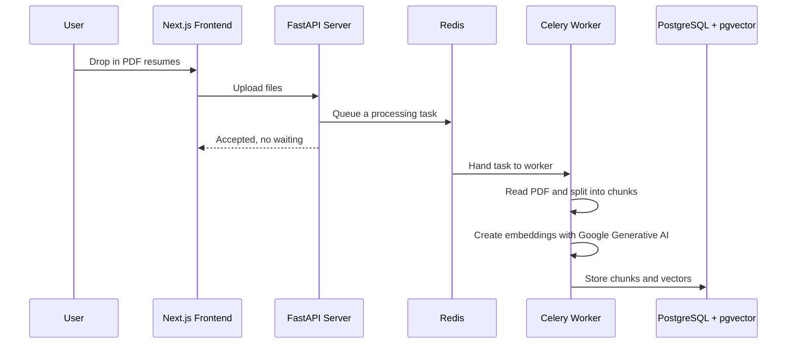
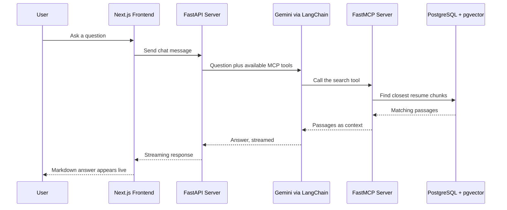
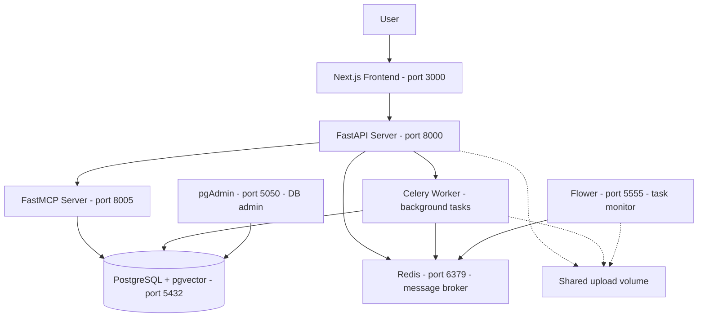

# MCP Applicant Tracking System: Chat With a Pile of Resumes

*I built a system where you drop in a stack of PDF resumes and then simply ask questions about them, in plain English, like talking to a very fast recruiter's assistant.*

## TL;DR

- Upload many PDF resumes at once; they're processed in the background so the app never freezes.
- Ask questions in a chat window ("Who has Python and cloud experience?") and get streamed, context-aware answers.
- Under the hood: resumes become searchable "meaning fingerprints" (vector embeddings) stored in PostgreSQL with pgvector, and the AI reaches them through an MCP server.
- The whole thing (frontend, API, workers, database, monitoring) starts with one `docker-compose up -d`.

## The problem

Imagine you're hiring and 80 resumes land in your inbox. You don't want to open each PDF. You want to ask, "Who has worked with payment systems?" or "Show me people with leadership experience."

Ctrl+F doesn't help much. Someone may write "built checkout and billing services" and never use the words "payment systems". Keyword search only matches exact words, while you care about meaning. And reading each resume by hand doesn't scale.

I wanted something that lets you talk to your resumes instead of digging through them.

## The idea

Think of a librarian who has read every resume once and filed it by *what it's about*, not by the words it uses. When you ask a question, the librarian doesn't flip through every page. They walk to the shelf where that topic lives, pull out the relevant passages, and then explain them to you in a sentence or two.

That's the system:

1. **Reading and filing:** each uploaded PDF is read, cut into small passages, and turned into a numeric fingerprint of its meaning.
2. **Finding:** your question gets a fingerprint too, and the closest passages are retrieved.
3. **Explaining:** a language model (Google's Gemini) writes the answer using those passages, streaming it word by word.

> **Plain-English glossary**
> - **Embedding:** a list of numbers that captures the meaning of a piece of text. Similar meanings give similar numbers.
> - **Semantic search:** searching by meaning rather than exact words.
> - **MCP (Model Context Protocol):** a standard way for an AI to use outside tools, like a universal plug between an AI and your data.
> - **Background worker:** a helper process that does slow jobs so the main app stays responsive.

## How it works

The journey has two halves: *getting resumes in* and *asking questions*.

### Getting resumes in



When you upload, the API doesn't process the files itself. It saves them to a shared upload folder, drops a note in a queue (Redis), and immediately replies. A separate worker picks up the note, reads the PDF, splits the text into chunks, creates embeddings, and stores everything in the database. You can upload many files without the page hanging.

### Asking questions



The chat model doesn't have direct database access. Instead, the API gives it a toolbox served by a separate MCP server. When your question needs resume data, the model calls the search tool, gets back the most relevant passages, and writes an answer from them. The answer streams back so you see it appear as it's written.

> **For the curious:** the agent logic lives in `fastapi-server/app/agents/mcp_agent.py`, and the MCP server is a small FastMCP app (`fastmcp-server/server.py`) that connects to the same PostgreSQL database.

## Under the hood

### Architecture



### Design decisions and why

- **Background processing with Celery and Redis.** Reading a PDF and calling an embedding API is slow. Doing it inside the web request would make uploads feel broken. A queue keeps the API quick and lets workers scale separately.
- **PostgreSQL with pgvector instead of a dedicated vector database.** One database holds the data and the vectors. That means fewer moving parts to run, and a familiar tool for administration (pgAdmin is included).
- **A separate MCP server for search.** Putting search behind MCP gives the AI a clean, standard tool interface. The chat agent and the data access are decoupled, so tools can be added or changed without rewriting the agent.
- **Chunking before embedding.** Resumes are split into smaller passages so retrieval returns focused snippets instead of whole documents.
- **Streaming responses.** Answers show up as they're generated, which feels far more responsive than waiting for the full reply.
- **Docker Compose for everything.** Each service is containerized, with health checks, so the stack starts the same way on any machine.

### Trade-offs

- It's a multi-service system, so it needs more resources than a single script. The README recommends 8GB+ RAM and 10GB+ free disk.
- It depends on a Google API key for both embeddings and the chat model.
- Default credentials and dev-style settings are meant for local use, not production as-is.

> **For the curious:** the README suggests an optional index for faster vector search on larger datasets:
> ```sql
> CREATE INDEX CONCURRENTLY ON documents USING ivfflat (embedding vector_cosine_ops);
> ```

### Tech stack

| Layer | Technology | Role |
|-------|-----------|------|
| API | FastAPI | Upload and chat endpoints, streaming |
| Background jobs | Celery + Redis | Asynchronous PDF processing |
| Database | PostgreSQL + pgvector | Storage and vector similarity search |
| AI framework | LangChain | Agent and model orchestration |
| AI models | Google Generative AI | Embeddings (`models/embedding-001`) and chat (`gemini-2.0-flash-exp`) |
| Tool protocol | FastMCP | MCP server exposing search |
| Frontend | Next.js 15 (Turbopack), TypeScript, Tailwind CSS, React Markdown | Chat UI with markdown rendering |
| Infrastructure | Docker, Docker Compose, Python 3.11+, Node.js 20, UV | Packaging and runtime |
| Monitoring | Flower, pgAdmin | Task and database visibility |

## Results and what I learned

I don't have benchmark numbers to share, and I'd rather not invent any. What I can say is what the project delivers:

- Multi-file PDF upload with drag and drop, processed asynchronously.
- Semantic search over resume content, with chat history persisted and streamed markdown replies.
- A full stack that runs from a single Compose command, with health checks and dashboards for the task queue and database.

What I learned:

- Anything slow belongs in a queue. It's the difference between an app that feels solid and one that feels broken.
- MCP is a nice way to keep the AI's "hands" separate from its "brain".
- Keeping vectors in Postgres keeps operations simple.

## Try it yourself

**Prerequisites:** Docker and Docker Compose, a Google API key for Generative AI, 8GB+ RAM recommended, 10GB+ free disk space.

**1. Clone**

```bash
git clone <repository-url>
cd assignment
```

**2. Configure**

```bash
cp fastapi-server/.env.example fastapi-server/.env
```

Edit `fastapi-server/.env`:

```env
# Database Configuration
PG_CONNECTION_STRING=postgresql://postgres:postgres@db:5432/resumedb

# Redis/Celery Configuration
CELERY_BROKER_URL=redis://redis:6379/0
CELERY_RESULT_BACKEND=redis://redis:6379/0

# Google AI Configuration
GOOGLE_API_KEY=your_google_api_key_here
EMBEDDING_MODEL=models/embedding-001

# System Configuration
UPLOAD_DIR=/tmp/resume_uploads
MODEL_NAME=gemini-2.0-flash-exp
MODEL_PROVIDER=google_genai
```

```bash
cp fastmcp-server/.env.example fastmcp-server/.env
```

Edit `fastmcp-server/.env`:

```env
PG_CONNECTION_STRING=postgresql://postgres:postgres@db:5432/resumedb
GOOGLE_API_KEY=your_google_api_key_here
EMBEDDING_MODEL=models/embedding-001
```

The frontend reads `NEXT_PUBLIC_API_URL` (default `http://localhost:8000`).

**3. Launch**

```bash
# Start all services
docker-compose up -d

# View startup logs
docker-compose logs -f

# Check service status
docker-compose ps
```

**4. Open the app**

| Service | URL | Purpose |
|---------|-----|---------|
| Main Application | http://localhost:3000 | Frontend chat interface |
| API Documentation | http://localhost:8000/docs | Swagger UI for API |
| Database Admin | http://localhost:5050 | pgAdmin interface |
| Task Monitor | http://localhost:5555 | Flower Celery dashboard |
| FastMCP Server | http://localhost:8005 | MCP protocol endpoint |

Default credentials (local use only): pgAdmin `admin@admin.com` / `admin`; PostgreSQL `postgres` / `postgres`.

To tune the database, you can open a SQL shell with:

```bash
docker-compose exec db psql -U postgres -d resumedb
```

## What's next and limitations

- The default credentials and settings are for local development. A production setup would need secrets management and hardening; the README sketches a Kubernetes deployment (3 replicas of the FastAPI server, port 8000) as a starting point.
- Search quality and answers depend on the Google models configured.
- Only PDF resumes are supported today.

## Links

- Repository: https://github.com/AbQaadir/mcp-chat-bot
- [FastAPI](https://fastapi.tiangolo.com/) · [Next.js](https://nextjs.org/docs) · [LangChain](https://docs.langchain.com/) · [pgvector](https://github.com/pgvector/pgvector) · [Celery](https://docs.celeryproject.org/) · [Google Generative AI](https://ai.google.dev/docs)
